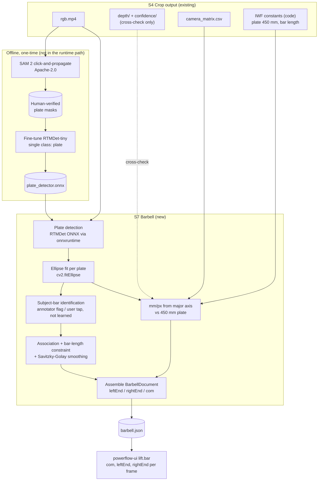

# S7 Barbell — Detection Model Recommendation

Status: **draft** | Scope: GitHub issue [#121](https://github.com/tony-yehui-lou/PowerFlow/issues/121) "Find a suitable model", under epic [#59](https://github.com/tony-yehui-lou/PowerFlow/issues/59) "Barbell Detection" | Updated: 2026-10-16

> **Superseded in part, 2026-10-19.** The detection target is no longer the plate face: it is the
> bar's own **cap** and **collar**, hand-labelled as boxes on sampled frames rather than tracked
> with SAM 2. What was built, what it measured, and why both changed is in
> [`S7-barbell-landmark-detection.md`](S7-barbell-landmark-detection.md). This document stands as
> the decision record for what did not change — detecting the bar rather than the athlete, refusing
> to learn subject identity, taking metric scale from a known bar dimension rather than LiDAR — and
> for the licensing and alternatives analysis behind the model choice.

## Executive Summary

S7 Barbell needs to turn one camera's S4-cropped RGB video into the `bar` block the UI contract
already fixes — `leftEnd[]`, `rightEnd[]` and `com` per frame (`powerflow-ui/docs/schema-normalized/lift.schema.json`).
The recommendation is to detect **the plate face, not the barbell**: a single-class detector
(**fine-tuned RTMDet, Apache-2.0, served as ONNX through the `rtmlib`/`onnxruntime` path the
pipeline already owns**) finds **every** plate in the frame, and an OpenCV ellipse fit inside each
detection refines the centre to sub-pixel. **Which pair belongs to the subject is never learned**:
it is not a visual property — a 25 kg plate on the floor and the same plate on a lifted bar are
pixel-identical — so it is supplied from outside the model (at inference, by the user; in this
corpus, by the annotator). Training labels come from **SAM 2 click-and-propagate** (Apache-2.0,
offline tool only), with every plate tracked through every frame, because no barbell annotation
exists anywhere in this repository and the one large public dataset that labels barbells —
Objects365, class 348 — is licensed for academic use only.

The single biggest finding: **do not plan on LiDAR depth for the bar.** Measured on
`22 August/Snch/107kgSnch1`, the athlete sits at 6.3–6.6 m — past the ~5 m rated range of the
pre-15-Pro LiDAR — the depth map is 186×250 against a 1408×1888 RGB frame (1 depth pixel ≈ 7.6 RGB
pixels, so the **bar shaft is about one depth pixel wide**), and the 4×4 depth patches at both
plate centres in the frame sampled contained **no confidence-2 returns at all**. The plate itself
is the better ruler: an IWF bumper plate is 450 mm ± 1 mm across for every weight from 10 kg to
25 kg, so the fitted ellipse's major axis yields metric scale per frame, from the same pixels the
detector already produces, with no sensor involved.

## Scope

Per the issue owner (2026-09-21): **the 22 August single-camera oblique capture is the target**.
`11 July` is covered by its **Front** camera only, and the July **Side** camera is out of scope.
That choice sets the hard case — one camera at roughly 45° azimuth, in a small gym, with
spectators and a second set of plates inside the frame.

## What the footage actually is (measured, 2026-09-21)

S4 crop output, `22 August/Snch/107kgSnch1`, frame 78 (mid-pull), and `11 July/30kg_Set1/Front`,
frame 155:

| Property | 22 August (oblique, single) | 11 July (Front) |
|---|---|---|
| RGB frame (post-crop) | 1408 × 1888 | 1420 × 1672 |
| Capture fps | 60 | 30 |
| Plate face on screen | ellipse ≈ 85 × 107 px (far end), ≈ 105 × 125 px (near end) | most of the frame height, near-circular |
| Bar end-to-end span | ≈ 330 px of 1408 | ≈ full frame width |
| Implied scale at the plate | **≈ 4.2 mm/px** (450 mm ÷ ~107 px) | roughly 1 mm/px |
| Depth map | 186 × 250 → 1 depth px ≈ 7.6 RGB px | 188 × 222 |
| Depth at plate centres | 5.76 m / 4.53 m, **0 of 16 patch pixels at confidence 2** | — |
| Confidence-2 share over the athlete+bar band | 26–42% across three sampled frames | 21% frame-wide |
| Median subject distance | 6.3–6.6 m | 7.05 m |
| Distractors in frame | loose plates and a plate stack in the near foreground, a plate rack, 5+ spectators | **a second lifter holding a loaded barbell overhead**, a plate rack, a loaded bar on the floor |

Two consequences follow directly and shape everything below. First, **a plate is a large,
high-contrast, closed shape of known physical size, and the bar shaft is not** — the shaft is thin,
specular, and occluded by both hands for most of the lift. Second, **"find a barbell" is not the
problem; "find *this* barbell" is** — both layouts put other plates, and in July another loaded
bar, inside the same frame.

The scale figure is worth stating plainly: at ~4.2 mm/px on August footage, one pixel of
centre jitter is 4.2 mm, and at 60 fps a one-pixel frame-to-frame wobble is **0.25 m/s** of
spurious bar velocity. Smoothing is not a polish step for #63's velocity and acceleration curves;
it is load-bearing.

## Requirements → Capabilities

| Capability | Priority | Description | Constraints |
|---|---|---|---|
| C1 · Plate instance detection | Must-have | Locate every plate face in each RGB frame | Permissive license required (closed-source commercial product, iPhone app planned); offline batch on a Prefect worker, no real-time bound; CPU-first, Python/ONNX-friendly; must survive oblique foreshortening, motion blur, and hand/body occlusion |
| C2 · Bar-end localisation | Must-have | Sub-pixel centre of each end plate → `leftEnd[]`, `rightEnd[]`; `com` as their midpoint | A bbox centre is biased when the plate is clipped by the frame edge or occluded; the plate is an **ellipse** under oblique view, with near and far ends at different scales |
| C3 · Subject-bar identification | Must-have | Know which detected pair is the bar the capture is about | **Not a detector responsibility and not learnable from appearance.** Supplied externally: the annotator records it for this corpus, the user supplies it at inference. Geometry can narrow the field but cannot settle it — a second athlete lifting simultaneously appears in this corpus |
| C4 · Temporal continuity | Must-have | One continuous track per bar end across the lift window, through occlusion and blur | Single object, known constant physical length between ends; dropouts must be represented, not silently interpolated away |
| C5 · Training labels | Must-have | Annotated plate instances to fine-tune on | **Zero barbell annotation exists in this repo**; COCO has no barbell class; Objects365 has one but is academic-use-only; 30 usable captures from two fixed rigs |
| C6 · Metric scale for bar ends | Nice-to-have here (owned by [#63](https://github.com/tony-yehui-lou/PowerFlow/issues/63) Barbell HVA) | Pixels → metres, for height/velocity/acceleration curves | LiDAR depth measured unreliable at this range (above); **every capture in the corpus uses IWF-standard equipment**, so plate diameter (450 mm) and bar length are fixed constants, not per-capture metadata — this is what makes the plate a usable ruler where `5-scaling.md` could not find one |

## Recommended Components

### C1 · Plate instance detection

- **Choice:** **Adapt** — fine-tune **[RTMDet](https://github.com/open-mmlab/mmdetection)-tiny/s** (MMDetection, Apache-2.0) as a **single-class `plate` detector** on PowerFlow's own frames; export to ONNX and serve it through `onnxruntime`, which `rtmlib` already pulls in for S5.
- **Why:** the deciding criterion is **license plus zero new runtime dependency**. RTMDet is Apache-2.0 end to end, and `rtmlib` — already a dependency, also Apache-2.0 — runs RTMDet-family ONNX models without `mmcv`/`mmdet` installed. So training-time `mmdet` stays an offline, dev-only concern while the pipeline gains no new runtime package. Detecting one rigid, high-contrast class from a fixed rig is an easy detection problem; architecture choice is genuinely low-stakes here, and reusing the S5 serving path is worth more than a point of COCO AP.
- **Alternatives considered:**
  - **[D-FINE](https://github.com/Peterande/D-FINE)-S / RT-DETRv2** (Apache-2.0) — modern DETR-family detectors with better COCO AP (D-FINE-S 48.5%) and a much easier install than `mmcv`. A fair substitute if `mmcv` build pain bites. **Caveat that matters:** D-FINE's `*_obj365` and `*_obj2coco` checkpoints are explicitly *not* commercially cleared by their own repo, because Objects365 is academic-only. Only the COCO-trained weights are usable here.
  - **Ultralytics YOLOv8/YOLO11** — rejected on licensing, on the same grounds [`S5-pose-model-recommendation.md`](S5-pose-model-recommendation.md) rejected YOLO-pose: AGPL-3.0 by default, commercial closed-source use requires an Enterprise License.
  - **[YOLO-World](https://github.com/AILab-CVC/YOLO-World)** (open-vocabulary) — GPL-3.0. The repo says commercial usage is "supported", but GPL-3.0 is still copyleft; shipping it inside a closed iPhone app is exactly the case that triggers it. Rejected.
  - **Zero-shot open-vocabulary detection as the production detector** — [GroundingDINO](https://github.com/IDEA-Research/GroundingDINO) (Apache-2.0) or [OWLv2](https://huggingface.co/google/owlv2-base-patch16-ensemble) (Apache-2.0) prompted with "barbell" / "weight plate". Attractive because it needs no labels, but rejected for production on three counts: boxes are loose where we need a sub-pixel centre, both are far heavier per frame than a tiny single-class CNN, and GroundingDINO's released weights list Objects365 in their training mix, which reopens the provenance question its Apache-2.0 header appears to close. Useful for a first look; not the thing to build on.
  - **Classical CV alone** (colour threshold + `HoughCircles` / contour + `fitEllipse`) — zero new dependencies, fully inspectable, and genuinely good *inside a known ROI*. Rejected as the primary detector because the frame contains other plates of the same colours, the plate is an ellipse of varying eccentricity rather than a circle, and the lifter's body cuts the contour. It is kept, deliberately, as the refinement step in C2.

### C2 · Bar-end localisation

- **Choice:** **Adapt** — `cv2.fitEllipse` on the plate edge inside each detected box (`opencv-contrib-python`, already a dependency), taking the ellipse centre as the bar end and the **major axis** as the plate's true diameter in pixels. Fall back to the box centre, flagged with reduced confidence, when the fit fails or is degenerate.
- **Why:** the ellipse fit uses the whole plate rim, so it stays centred when the rim is partly clipped or occluded, where a box centre shifts with whatever part of the plate is visible. It also hands C6 the scale ruler for free: under perspective the major axis is (to first order) the unforeshortened 450 mm diameter, while the minor axis encodes the viewing obliquity. No model, no new dependency, and the geometry is verifiable on synthetic fixtures the way `CLAUDE.md` requires.
- **Alternatives considered:**
  - **RTMDet-Ins / instance segmentation** — a per-plate mask, then fit the ellipse to the mask boundary. Strictly better under heavy occlusion and the right upgrade if the box-plus-fit path proves brittle, at the cost of a heavier export and a mask head to maintain. Recommended as the documented fallback, not the starting point.
  - **Two-keypoint pose formulation** (train RTMPose to regress "left bar end" / "right bar end" directly) — appealingly direct and would reuse S5's serving code almost verbatim, but it gives a point with no plate diameter, discarding the scale ruler C6 depends on, and single-instance keypoint regression has no natural way to express "there are three other plates in this frame". Rejected.

### C3 · Subject-bar identification

- **Choice:** **Do not learn it.** The detector emits every plate it can see. Which pair is the
  subject's bar arrives from outside the model: **the annotator records it** for this corpus (a
  `subject` flag on the tracked pair, never a class in the detector's loss), and **the user supplies
  it at inference** — the recording UI asks them to tap their barbell, which is designed separately
  alongside the app. Geometry then does the small remaining job: pair the tapped plate with its
  collinear partner at plausible separation, and track both.
- **Why:** subject-hood is not visible. A 25 kg plate on the floor and the same plate on a lifted
  bar are pixel-identical, so the only cues a model could learn are position-in-frame and apparent
  size — precisely the rig-specific shortcuts that fail in a new gym. Supplying the answer from
  outside costs one tap and removes the failure mode entirely, instead of hiding it inside a
  heuristic that works on the footage we happen to own.
- **The tap also relaxes what the detector must do.** Its job becomes recall in a small
  neighbourhood rather than discrimination across the frame, so background false positives cost
  nothing downstream.

#### The heuristic fallback, and its measured limit

Archival footage has nobody to tap. For that case only, a rule can narrow the field — stated here
with its limits rather than as a solution:

1. **Pair** plate detections that are roughly collinear with the frame's horizontal (after S3's
   levelling) and separated by a plausible bar length.
2. **Filter by physical plausibility, not by rank.** Each candidate carries its own scale, because
   every IWF plate is 450 mm across whatever its distance, so its vertical travel converts to
   metres independently of how far away it is. Measured over 11 labelled captures, real snatches
   land at **1.06–1.72 m**; a plate being carried, or a bar being racked, does not produce that.
   This replaces the earlier "largest vertical excursion" rule, which conflated *big lift* with
   *near camera*.
3. **Rank what survives by measured distance** — 450 mm subtending N pixels at a known `fx` gives
   range directly, so "nearest the camera" is computed rather than assumed.
4. **Refuse when it is still ambiguous.** Two athletes lifting at comparable distance cannot be
   separated by geometry. `22 August/Snch/38kgSnch1` contains exactly this: a second athlete walks
   to a loaded bar and begins pulling it while the subject is mid-snatch. Picking one silently
   yields a velocity curve that looks entirely plausible and belongs to the wrong person — the
   worst failure mode for a coaching product, because nothing appears broken. The pipeline already
   holds this discipline elsewhere: *rejected with a reason, never emitted degraded*.

- **Alternatives considered:**
  - **Cross-check against S5 wrists** (pick the bar whose shaft passes near both detected wrists) —
    the right structural answer for the no-tap case, since it reduces "which bar" to "which person",
    a better-posed question. Blocked today: `S5-pose-model-recommendation.md` records the detector
    running `num_poses=1` and selecting a **bystander** on real frames. Worth revisiting once S5's
    subject selection is fixed.
  - **Largest-plate heuristic** — fails on the August foreground stack, which is nearer the camera
    than the athlete and therefore larger on screen.
  - **Teaching the detector a "subject plate" class** — rejected on principle above: it would train
    position, not appearance.

### C4 · Temporal continuity

- **Choice:** **Build (small)** for production — per-frame detection, nearest-centre association between consecutive frames, a **constant bar-length constraint** in metric space to reject impossible pairings, and Savitzky-Golay smoothing (`scipy`, already a dependency) before any derivative is taken. Dropouts stay explicit, mirroring `JointSeries`'s `None`-pixel-iff-zero-confidence convention rather than being interpolated away silently.
- **Why:** the subject's bar is a rigid body of known length, tracked from a fixed camera, offline — and once C3 has identified it, following it is a two-point problem, not a crowded-scene association problem. A tracking-by-detection framework (ByteTrack, BoT-SORT) is built for crowded multi-object association and would add a dependency to solve a problem two plates do not have. The published single-camera snatch work follows the same shape — a detector to localise, then a 2D tracker for the centre — and reports trajectory deviations of only a few centimetres against manually initialised tracks.
- **Alternatives considered:**
  - **[SAM 2](https://github.com/facebookresearch/sam2) video propagation** (Apache-2.0, code and checkpoints) — click each plate once on the first frame and propagate masks through the clip. Excellent, and recommended — but as the **labelling tool** (C5), not as a runtime component: it needs a prompt per clip and is far heavier than the production path needs.
  - **OpenCV trackers (CSRT/KCF), as the existing OSS bar-path projects use** — they need manual initialisation per clip and drift through occlusion; the surveyed projects mostly sidestep detection entirely by requiring a **high-contrast marker taped to the bar end**, which archival footage does not have.

### C5 · Training labels

- **Choice:** **Adapt** — bootstrap with **SAM 2** click-and-propagate over the existing corpus, then human-verify. **Every plate face in the frame is clicked and tracked through every frame** — the subject's bar, floor plates, the rack, another athlete's bar — and the subject's pair carries a `subject` flag that never reaches the detector's loss. Nothing is treated as static scenery: other athletes lift mid-capture and plates are carried in and out, measured directly in `38kgSnch1` and `60kgSnch2`, so a one-frame annotation held constant would assert plates that are no longer there. Sample a **stratified subset of frames** for training (all captures, across setup / pull / catch / recovery, with occluded and motion-blurred frames over-represented), since consecutive frames from a tripod that never moved are nearly redundant. Hold out whole captures — never frames from a training capture — for evaluation.
- **Why every plate, with nothing excluded:** a plate present and unlabelled is trained as background, and the rig never moves, so an unlabelled plate sits at identical pixels in every frame of every capture from that tripod — the strongest possible signal for "plates here are background", and the one thing that could make the detector suppress the subject's plate at floor level during setup. Region-level exclusions were considered and rejected: they trade a correctness problem for a coverage problem, and they do not survive the move to a new gym where no such region is defined.
- **Why:** it converts the dataset problem from "annotate a new class" into "confirm a propagated mask", and it keeps the labels entirely first-party, which sidesteps every dataset-licensing question below.
- **Alternatives considered:**
  - **Objects365** — has a `Barbell` class (index 348) and is the obvious shortcut. **Rejected:** the dataset is released for academic purposes only, which also taints any checkpoint pretrained on it (D-FINE says so explicitly for its own `obj365` weights).
  - **Roboflow Universe barbell datasets** — several exist, listed as CC BY 4.0 or MIT, which would be usable with attribution and would add out-of-rig diversity the two gyms cannot supply. Worth revisiting once a first model exists, **after verifying each dataset's license on its own page** — the listings could not be fetched during this pass (HTTP 403), so the licenses quoted in search results are unconfirmed, and Universe licenses are uploader-declared rather than audited.
  - **Synthetic rendering** of plates over gym backgrounds — plausible, and unnecessary at this scale; 31 captures from two fixed rigs is a narrow enough domain that a few hundred real labelled frames should saturate it.

### C6 · Metric scale for bar ends

- **Choice:** **Adapt** — derive millimetres-per-pixel per frame from the fitted ellipse's **major axis against a known plate diameter** (450 mm ± 1 mm for every IWF bumper from 10 kg to 25 kg), with LiDAR depth kept only as an independent cross-check, never as the primary source.
- **Why:** measured, not assumed — see the table above. At 6.3–6.6 m the subject is beyond the ~5 m rated range of the pre-15-Pro LiDAR (unrecorded which device was used — see Gaps), the bar shaft is roughly one depth pixel wide, and the depth patches at both plate centres in the sampled frame carried no confidence-2 returns. A 450 mm object that is ~107 px across in the same image *is* a ruler, it is in the same pixels the detector already produced, and it rescales itself automatically as the athlete moves toward or away from the camera. This also revives, on a sound footing, the measurement that [`5-scaling.md`](5-scaling.md) retired an entire stage for want of: that document's blocker was that nothing told the pipeline **where** the reference was in the frame or **how big** it was — C1/C2 answer the first, and a recorded plate diameter answers the second.
- **Alternatives considered:**
  - **Depth back-projection, reusing S6 Lift** — architecturally the tidiest answer, since S6 already does exactly this for joints, and it would cost almost nothing to implement. Rejected as *primary* on the measurements, not on principle; it remains the right cross-check, and it is the better primary for any future capture shot inside ~4 m.
  - **Bar length as the ruler** (2200 mm men's / 2010 mm women's) — a second known dimension, but it is a length *between* the two detections, so it is unavailable whenever one end leaves the frame, and it cannot be measured at all on a single plate. Better used as a consistency check on the plate-derived scale than as the scale itself.

## Architecture Diagram

## Build-vs-Buy Tradeoffs

Two calls were genuinely ambiguous. The rest resolved cleanly on license (C1's rejections) or on
the absence of any candidate to buy (C3, C4).

### C1 · How to get plate detections

| Option | Type | Time-to-value | Maintenance burden | Lock-in risk | License / cost | Ops cost | Fit notes |
|---|---|---|---|---|---|---|---|
| Fine-tuned RTMDet-tiny (ONNX) | Adapt (OSS) | Medium — needs C5's labels first | Low — one small checkpoint, served by the `onnxruntime` path S5 already uses | Low — ONNX is portable off `mmdet` entirely | Apache-2.0, free | Low — CPU-friendly single-class CNN | Purpose-fit to this rig; the only option that gives tight boxes for the ellipse fit |
| Zero-shot GroundingDINO / OWLv2 | Adopt (OSS) | **Fast — no labels at all** | Medium — a large VLM-scale model to version and serve | Medium | Apache-2.0 headers, but GroundingDINO's weights list Objects365 (academic-only) in their training mix | High — heaviest per-frame cost of the three | Loose boxes; prompt sensitivity; still needs C2's fit to be usable |
| Colour + Hough/ellipse, no model | Build (classical) | **Fastest — days, zero labels, zero new deps** | Low, but brittle: every new gym is a new threshold | None | Free | Lowest | Cannot separate the athlete's plates from identically-coloured floor plates; breaks under occlusion |

Time-to-value favours the two label-free options, and that is the only axis on which they win.
The deciding criterion is **what C2 needs downstream**: a centre good to a couple of pixels, on
occluded and motion-blurred frames, with other plates in shot. Zero-shot boxes are too loose for
that and cost the most to run; pure classical CV has no way to reject a distractor plate of the
same colour. The fine-tuned detector's one real cost — labels — is largely neutralised by C5's
SAM 2 bootstrap, which turns annotation into verification.

**Recommendation: fine-tune RTMDet-tiny as a single-class plate detector, and keep zero-shot
prompting as a one-afternoon sanity check before investing in labels, not as the product.**

### C6 · Where metric scale comes from

| Option | Type | Time-to-value | Maintenance burden | Lock-in risk | License / cost | Ops cost | Fit notes |
|---|---|---|---|---|---|---|---|
| Plate diameter as ruler (450 mm) | Adapt (custom, reuses C2's fit) | Fast — the ellipse is already fitted | Low — pure geometry, testable on synthetic fixtures | None | Free | None | Self-rescaling as the athlete moves; a fixed constant across the corpus, so nothing to record |
| LiDAR depth back-projection | Adapt (reuses S6) | Fastest — S6 already implements it | Low — shared with S6 | None | Free | Low | Measured unreliable here: 6.3–6.6 m subject distance, no confidence-2 returns at the sampled plate centres, bar ≈ 1 depth pixel wide |
| Bar length as ruler (2200/2010 mm) | Build | Fast | Low | None | Free | None | Unavailable whenever one end leaves frame; men's vs women's bar is separable from the measurement itself (a 9% difference, ~20 px at August scale) |

The criteria that usually decide this — cost, lock-in, ops — are identical across all three.
**Measurement decides it.** Depth is the tidiest architecture and the one already built, and the
sensor data at this range does not support it; the plate is a certified-tolerance physical
reference sitting in the same pixels the detector already returns.

**Recommendation: plate-diameter scale as primary, depth back-projection retained as an
independent cross-check and as the primary for any future capture inside ~4 m.**

## Gaps / Custom-Build Items

- **~~Plate diameter is recorded nowhere~~ — closed (2026-09-21).** The issue owner confirms
  every capture in the corpus uses **IWF-standard equipment**, so plate diameter is **450 mm
  ± 1 mm** and bar length is the IWF standard, both as fixed constants in code rather than
  per-capture metadata. The July plates look unlike the August bumpers on screen (white/steel
  faced, branded "CLUSTER") but are IWF-spec, and IWF spec fixes the diameter for every plate
  from 10 kg to 25 kg regardless of finish. This is what `5-scaling.md` was missing: it needed
  *where* the reference is (C1/C2 now answer that) and *how big* it is (a constant, now known).
  Two constants belong in one place — a `barbell_constants.py` beside the geometry, not scattered
  across tasks — and **men's (2200 mm) versus women's (2010 mm) bar is a 9% difference, roughly
  20 px at August scale, so it is measurable from the footage rather than declared.**
- **Capture device model is not recorded.** `record.json` carries intrinsics but not the phone.
  Whether the LiDAR's usable range is ~5 m (pre-15 Pro) or ~10 m (15 Pro and later) changes how
  much weight the depth cross-check deserves, and nothing in the pipeline can currently answer it.
- **`BarbellDocument` does not exist.** `common/models.py` defines `JointId`, `Skeleton` and
  `PoseDocument`, and nothing for the bar. S7 needs the analogous model plus a storage layout
  (`s7_barbell_output/<capture path>/barbell.json`, write-once, per `pose_storage.py`), and a
  matching `barbell.schema.json` under `powerflow-ui/docs/schema-normalized/` to close the loop
  with the UI's `lift.bar` block. Separate issue; not this one.
- **Subject-bar identification** (C3) is a UI concern at inference and a recorded flag in the
  corpus; the **heuristic fallback** for untapped archival footage and **the association/smoothing
  layer** (C4) are both
  first-party code with no external candidate — small, pure, and exactly the kind of geometry
  `CLAUDE.md` requires to be verified numerically on synthetic fixtures.
- **Label tooling.** SAM 2 is an offline dependency for producing labels, not a pipeline package.
  Where it lives (a `scripts/` entry point, a separate env) needs deciding before anyone installs
  it into `powerflow-pipeline`.

## Risks & Open Questions

- **Yaw is still uncorrected — and the bar is the fix.** S3 removes tilt and roll but never yaw,
  so on an oblique August capture the floor-frame's horizontal axes are the camera's, not the
  athlete's; `S5-pose-model-recommendation.md` already warns that reading horizontal components as
  sagittal displacement is wrong by an unrecorded factor. Vertical bar height, velocity and
  acceleration — what `docs/requirements.md` actually asks for — are unaffected. Horizontal bar
  drift is **not trustworthy on August footage today**. The opportunity: two plate centres define
  the bar's direction in the image, and the bar is the athlete's mediolateral axis by
  construction, so S7's own output is a candidate yaw reference for the whole capture. Worth a
  spike; out of scope for #121.
- **New dependency approval.** Per `powerflow-pipeline/CLAUDE.md`, nothing here should be
  installed without an explicit decision. The runtime cost of this recommendation is deliberately
  zero — `onnxruntime`, `opencv-contrib-python` and `scipy` are all present. `mmdet`/`mmcv`
  (training) and `sam2` (labelling) are new, offline-only, and `mmcv` in particular is a known
  install headache; D-FINE is the escape hatch if it is not worth the fight.
- **No accuracy validation yet.** Nothing in this document has been run against PowerFlow footage.
  Before committing, a spike should establish, on two held-out captures: detection rate over the
  lift window, median plate-centre error against manual annotation (the useful target is ≲ 2–3 px
  ≈ 1 cm at August scale), and the standard deviation of the plate-to-plate distance in millimetres
  once the scale is applied — that last one is a free self-consistency check, since a barbell's
  length does not change.
- **Motion blur at the second pull is the hardest frame class.** It is also the moment peak
  velocity is measured, so evaluation must weight it explicitly rather than reporting a mean over
  all frames where the setup and recovery dominate.
- **A second athlete lifting simultaneously is in the corpus, not hypothetical.**
  `22 August/Snch/38kgSnch1` shows a background athlete setting up and pulling a loaded bar while
  the subject snatches. No appearance model and no physical filter separates that case — both bars
  produce a real lift. It is the direct evidence for C3's "supplied from outside the model"
  choice, and for refusing rather than guessing when the fallback is all that is available.
- **`22 August/Snch/58kgSnch2` contains no lift.** Its subject bar travels 6 cm across the whole
  50-frame clip: S1's cut window caught the setup and missed the lift. Keep it out of the training
  splits until the window is fixed; it is a data defect, not a labelling one.
- **One rig, one gym, 28 of 30 captures.** A detector fine-tuned on this corpus will be excellent
  on this tripod and unproven anywhere else. The CC-licensed Universe datasets, or footage from a
  third gym, are the cheapest hedge before any claim of generality.
- **Frame-edge clipping in July.** The Front camera sits low and close, and the bar spans nearly
  the full width; a plate partly outside the frame has no complete rim to fit. The ellipse fit
  must detect and flag partial arcs rather than returning a confidently wrong centre.

## Sources

**Detectors and licenses**
- [open-mmlab/mmdetection](https://github.com/open-mmlab/mmdetection) — Apache-2.0; includes RTMDet; latest release 3.3.0 (May 2024), maintenance cadence has slowed.
- [Tau-J/rtmlib](https://github.com/Tau-J/rtmlib) — Apache-2.0; runs RTMDet/YOLOX/RF-DETR ONNX models through `onnxruntime` with no `mmcv`/`mmdet`/`mmpose` install. Already a dependency of this repo.
- [Peterande/D-FINE](https://github.com/Peterande/D-FINE) — Apache-2.0 code; D-FINE-S 48.5% COCO AP; repo states Objects365-pretrained checkpoints "should not be assumed to be commercially cleared under the D-FINE license".
- [AILab-CVC/YOLO-World](https://github.com/AILab-CVC/YOLO-World) — GPL-3.0; copyleft, unsuitable for a closed-source client.
- [Ultralytics license](https://www.ultralytics.com/license) — AGPL-3.0 by default; rejected on the same grounds as in [`S5-pose-model-recommendation.md`](S5-pose-model-recommendation.md).
- [IDEA-Research/GroundingDINO](https://github.com/IDEA-Research/GroundingDINO) — Apache-2.0; weights trained on O365/GoldG/Cap4M (Swin-T) — Objects365 provenance noted.
- [google/owlv2-base-patch16-ensemble](https://huggingface.co/google/owlv2-base-patch16-ensemble) — Apache-2.0; zero-shot text-conditioned detection; heads fine-tuned on COCO/OpenImages.
- [facebookresearch/sam2](https://github.com/facebookresearch/sam2) — Apache-2.0 code **and** checkpoints; video mask propagation from a click prompt; SAM 2.1 released 2024-09-29.

**Datasets**
- [Objects365](https://www.objects365.org/download.html) — "available for the academic purpose only"; class list includes `Barbell` (index 348) and `Dumbbell` (322), confirmed against the [Objects365 class list](https://raw.githubusercontent.com/ultralytics/ultralytics/main/ultralytics/cfg/datasets/Objects365.yaml).
- Roboflow Universe barbell datasets — [Gym Pal](https://universe.roboflow.com/gym-pal/barbell-object-detection), [jong](https://universe.roboflow.com/jong-o8aun/barbell-detection-2), [barbell (MIT)](https://universe.roboflow.com/barbell-yvyej/barbell-zwl3l). Licenses (CC BY 4.0 / MIT) are **from search listings only — the pages returned HTTP 403 to direct fetch and must be verified before use.**

**Prior art**
- [Single-Camera Barbell Trajectory Analysis for the Snatch Lift](https://link.springer.com/article/10.1007/s42979-026-04875-z) — YOLO-based localisation then 2D tracking; YOLO initialisation changed mean trajectory deviation by only a few centimetres versus manual initialisation.
- [tlancon/barbellcv](https://github.com/tlancon/barbellcv), [kostecky/VBT-Barbell-Tracker](https://github.com/kostecky/VBT-Barbell-Tracker), [Marticles/barbell-path-tracker](https://github.com/Marticles/barbell-path-tracker) — the established OSS approach relies on a high-contrast marker on the bar end or manual tracker initialisation; neither is available on archival footage.

**Physical references**
- IWF competition bumper plates are 450 mm ± 1 mm in diameter for every weight from 10 kg to 25 kg, colour-coded green/yellow/blue/red — see [Rogue KG Competition Plates (IWF)](https://www.roguefitness.com/rogue-kg-competition-plates-iwf) and [Weight plate (Wikipedia)](https://en.wikipedia.org/wiki/Weight_plate).
- iPhone LiDAR effective range ≈ 5 m on pre-15-Pro devices, extending to ~10 m on iPhone 15 Pro and later, with noise dominating beyond ~4 m — [OpenCV.ai depth estimation overview](https://www.opencv.ai/blog/depth-estimation), [Apple Developer Forums: depth accuracy of the LiDAR](https://developer.apple.com/forums/thread/650321).

**This repository (measured or read directly, 2026-09-21)**
- `../data/s4_crop_output/22 August/Snch/107kgSnch1` frames 26/78/131 and `../data/s4_crop_output/11 July/30kg_Set1/Front` frame 155 — every figure in "What the footage actually is".
- `powerflow-ui/docs/schema-normalized/lift.schema.json` — the `bar` contract (`com`, `leftEnd`, `rightEnd`) this stage must satisfy.
- [`5-scaling.md`](5-scaling.md) — the retired Scaling stage, and the two missing measurements C1/C2/C6 now supply.
- [`S5-pose-model-recommendation.md`](S5-pose-model-recommendation.md) — the licensing precedent, the `Detector2D` seam this stage should mirror, and the subject-selection defect C3 must not depend on.
- `src/powerflow_pipeline/data/common/pose_storage.py`, `.../common/models.py`, `.../preprocess/pose_model.py` — the storage, model and detector-boundary patterns S7 should follow.
